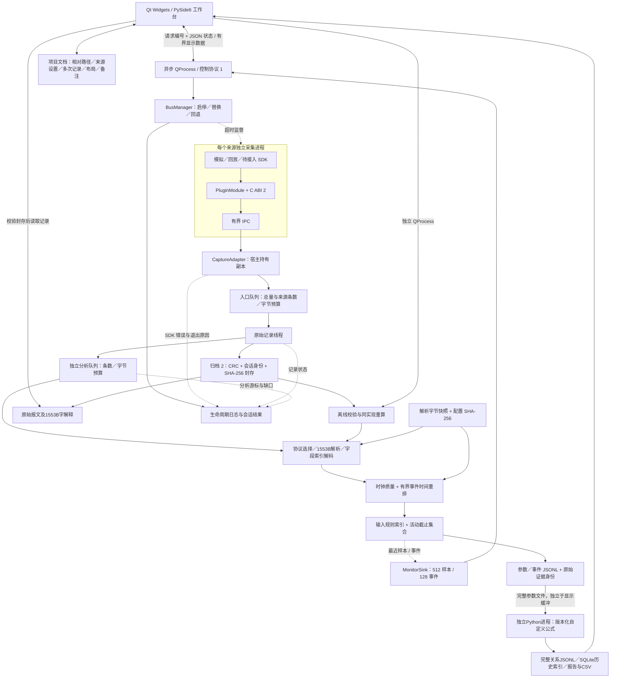

# 当前架构 · v0.6.0

面向地面试验和总线监测。Qt Widgets 前端通过异步进程接口接入；1553B合成监控记录的协议处理已接入，设备 SDK、原生捕获格式和真实 ICD 待接入。

原始记录是数据保留路径。分析停止、收尾失败或积压溢出会终止本次在线分析，但原始记录继续；离线重算从完整归档重新开始。分析游标是最后消费的原始位置，不能据此在文件中间恢复带状态的关联分析。

宿主不加载设备动态库。每个来源独立加载插件，加载、配置、启动、停止和销毁都受父进程监督。Windows 使用双向独立命名管道的重叠 I/O，启动时限制继承句柄，并把子进程直接放入随父退出终止的 Job。某个 SDK 卡住时终止该工作进程，其余接收线程和来源继续运行。此边界隔离用户态 SDK，内核驱动故障仍需设备阶段验收。

| 模块 | 责任与扩展点 |
| --- | --- |
| Qt `MainWindow` / `BackendClient` | 会话、采集源和分析展示；独立的“开始采集”按钮；异步进程控制；关闭等待封存 |
| `PluginCenter` / 插件说明文件 | 插件启用/停用、功能详情与当前来源状态；启用只准备配置，由“开始采集”开始获取数据 |
| `RelationsPage` / `RelationEngine` | 多选参数、命名公式、同组时基及窗口/有效时间检查、公式白名单、结果曲线与证据 |
| `runControlConsole` / `MonitorSink` | 结构化操作与状态响应；有界增量显示；不改变记录及分析语义 |
| `BusManager` | 实例代次、来源生命周期、候选预检、替换及失败回退；不持全局表锁等待来源停止 |
| `CaptureAdapter` / `WorkerProcess` | 有界消息、异步状态、命令截止、进程退出、终止与宿主接收副本 |
| `PluginModule` | 只在采集进程中加载 ABI 2 动态库并校验函数表 |
| `FramePipeline` | 原始和分析独立线程/队列、按来源排空、计数及资源预算 |
| `ArchiveWriter/Reader` | 独占创建、边界/CRC 检查、结束封存及输入完整性判定 |
| `BackendConfiguration` | 严格加载 schema 2、状态预算预检、准确快照及内容身份 |
| `DictionaryDecoder` | 按协议/通道/来源选择字段，保存工程量和原始证据身份 |
| `ProtocolPipelineDecoder` / 1553B协议对象 | 显式输入绑定、自动/手动选择、按流/代次解析；按RT/子地址/方向选择字典；持久化诊断与坏帧质量中断 |
| `ProcessingService` | 显式时钟质量、允许迟到范围、规则输入索引与活动响应截止 |
| `SessionJournal` / 会话结果 | 来源配置和故障持久化，采集/记录/分析状态分开报告 |

源内按参数有序、跨来源迟到界和显式时钟映射是分析输入契约，不由来源名称或电脑等待时间推断。空闲时需要调用方验证的事件水位；不自动把 SDK 空闲变成设备超时。SDK 故障使整次采集降级，期间分析结果保留用于诊断，不能通过成品采集验收。

内存预算涵盖入口队列、分析队列、单来源排队、来源历史容量、参数状态、重排样本和结果历史。IPC 消息也有大小上限。SDK 自身缓存、驱动缓存、硬件丢帧计数和绝对吞吐指标需要随设备接入确定。配额用于约束热来源，不等同于带权公平调度。

当前只支持新插件和新格式；没有旧版适配链。新增真实设备时按 C ABI 2 实现设备对象，业务分析留在宿主。1553B软件输入已通过 `IProtocolPipelineDecoder` 接入；自动选择依据显式输入表示和项目监控封装特征，未实现从未知物理波形识别协议。在线和离线使用相同的协议及参数处理对象。
